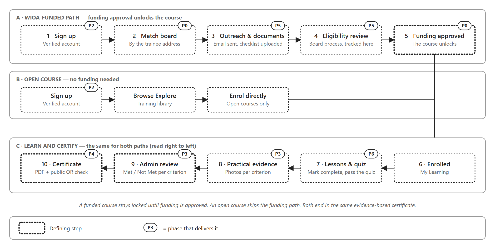
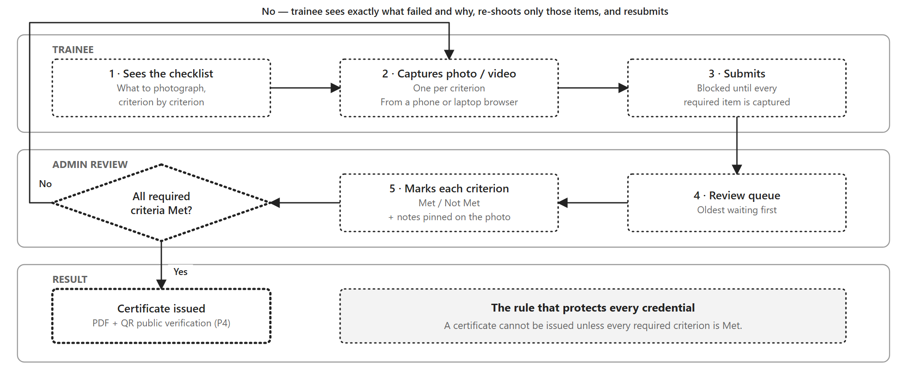
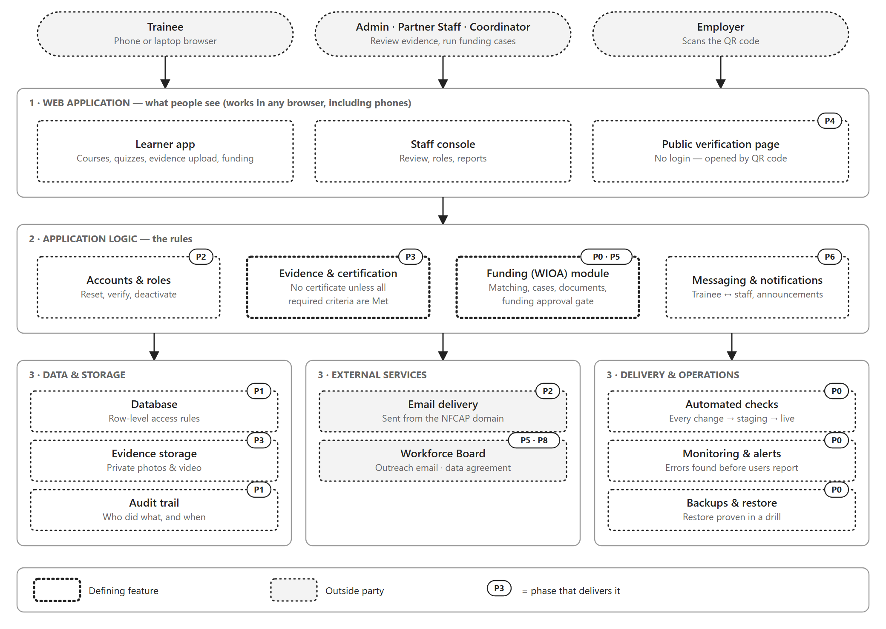
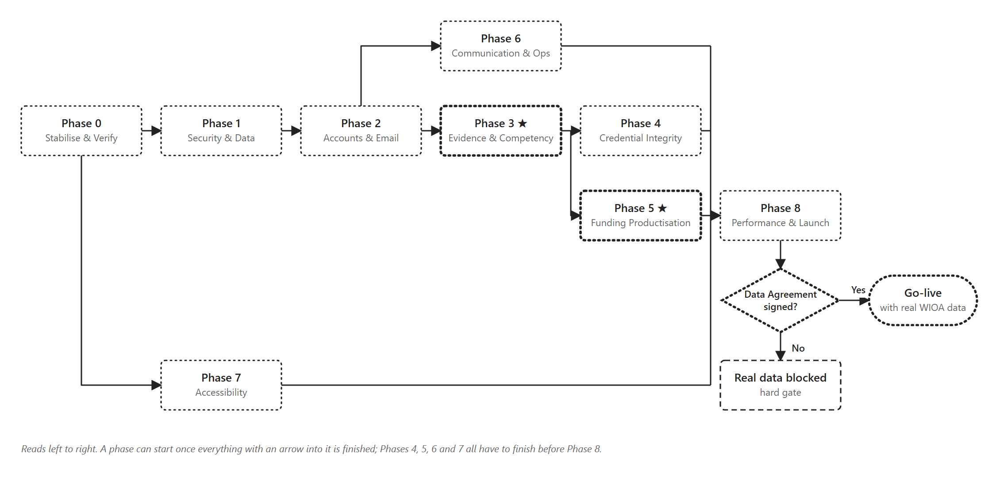
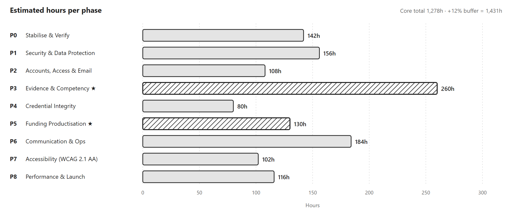

# NFCAP LMS — Build Plan

*A web application for apprentices, NFCAP admins and WIOA funding staff.*

## 1. At a Glance

| Scope | Effort | Timeline | Hard gate |
|---|---|---|---|
| **65 features** in **9 phases** | **1,431 hours** (1,278 core + 12% buffer) | **~18 weeks / ~4 months** with 2 engineers *(team size: [CONFIRM])* | Real WIOA data cannot enter the system until the **Workforce Board Data Agreement** is signed ([Phase 8](#phase-8)) |

This is a **web application only**. A mobile app is deliberately not part of the build; it is a future add-on, only if needed. Eight further items (**add-ons**) are held outside this scope and quoted separately — see [section 7](#7-add-ons-quoted-separately).

**Two phases define the product:** [Phase 5](#phase-5), which turns WIOA funding into a clear, working process, and [Phase 3](#phase-3), which makes certification depend on real, assessed evidence. Funding gets a trainee into a course; evidence is what earns the certificate.

**How to read this plan.** Sections 2 to 4 show what the system does: the trainee's journey, how staff and admins run it, and the 13 modules it is made of. Section 6 shows how and when it is built, phase by phase. Every journey step and module names the phases that build it.

## 2. The Product Journey

NFCAP LMS takes a trainee from funding, to a course, to a certificate. A **WIOA-funded** trainee goes through steps 1 – 5, and funding approval unlocks the course. A trainee on an **open course** signs up and enrols directly at step 6. After that, everyone follows the same steps 6 – 10.

NFCAP does not run the WIOA process; the workforce board does. There is no link to any government system. The connection is human: an email, a phone call and status updates entered by NFCAP staff.

### The ten steps

| # | Step | What happens | Who acts | Built in |
|:-:|---|---|---|---|
| 1 | **Sign up** | A short profile only: name, date of birth, email and phone, address, employment and unemployment-insurance status, training interest. The address drives step 2. The full workforce-board application is **not** part of sign-up. | Trainee | [Phase 2](#phase-2) |
| 2 | **Match board** | The address picks the workforce board, career centre and contact. If there is no match, staff resolve it by hand. | Automatic | [Phase 0](#phase-0) |
| 3 | **Outreach and documents** | The trainee reviews and sends a pre-written email to the board (logged). They upload files against **that board's checklist** (ID, proof of residency, right to work, resume, unemployment letter, Selective Service, veteran status). Staff accept, reject or ask for a resubmission. | Trainee, Partner Staff | [Phase 5](#phase-5) |
| 4 | **Eligibility review** | Orientation, CalJOBS account, the **application form** (demographics, family income, education, public assistance, barriers, signature), intake appointment and the eligibility decision all happen **with the board, outside the system**. Staff record each status here. | Board; staff record | [Phase 5](#phase-5) |
| 5 | **Funding approved** | Training programme chosen, funding requested, case-manager review, training authorisation and tuition approval, each tracked as its own milestone. Approval unlocks that one course for that trainee. | Board; Coordinator records | [Phase 5](#phase-5) |
| 6 | **Enrolled** | The course appears in My Learning. | Trainee | Core system |
| 7 | **Lessons and quiz** | Lessons marked complete, then a knowledge quiz. | Trainee | [Phase 6](#phase-6) |
| 8 | **Practical evidence** | Photo or video against each named criterion; no submission until every required item is captured. | Trainee | [Phase 3](#phase-3) |
| 9 | **Admin review** | Each criterion marked Met or Not Met, with notes pinned on the photo. Failures send the trainee back to re-shoot only those items. | Admin | [Phase 3](#phase-3) |
| 10 | **Certificate** | Issued only if every required criterion is Met. A PDF with a public QR code anyone can verify. | Automatic | [Phase 3](#phase-3), [Phase 4](#phase-4) |

Only one workforce board's packet (Tri-Valley Career Center, Alameda County) is on file so far. Other boards will have their own checklists; see the decisions in [section 8](#8-decisions-needed-from-nfcap).

**The rule that matters most:** a funded course stays locked until tuition is approved, so no one starts training that funding might later refuse to pay for. Open courses never touch the funding process.

### Steps 8 – 10 in detail

Phase 3 builds this loop: structured, photographic proof of real work, assessed criterion by criterion, with certification that cannot be issued unless the assessment is complete.

## 3. How Staff and Admins Run It

The journey above is the trainee's view. Behind it, NFCAP staff work in separate areas of the same web app: Admin runs the training, and funding staff run the WIOA cases. A platform layer supports both.

| Role | Sees and does |
|---|---|
| **Trainee** | Own stage, next step, documents, appointments, lessons, evidence |
| **Partner Staff** | Only their assigned trainees: progress, missing documents, follow-up notes. No funding amounts |
| **WIOA Coordinator** | All funding cases, communications, appointments and funding requests |
| **Admin** | Courses and pathway, learners and cohorts, evidence review, roles, reports, plus workforce boards, contacts and document checklists |

## 4. Product Modules

Everything in the plan belongs to one of 13 modules, so nothing is left out. Each row shows what the module does and which phases and hours deliver it.

| Module | Used by | What it does | Phases | Hours |
|---|---|---|---|---:|
| **Accounts & Profile** Learner | Trainee | Sign in and manage an account: password reset, email verification, account settings, secure sessions | [Phase 2](#phase-2) | 56 |
| **Learning & Quizzes** Learner | Trainee | Structured lessons marked complete by the learner, then a knowledge quiz with several question types, question banks, random order and attempt limits | [Phase 6](#phase-6) | 32 |
| **Evidence & Portfolio** Learner | Trainee | Trainees submit real photo and video evidence against each named criterion, get clear feedback, resubmit only what failed, and keep a portfolio of verified work (optionally shareable) | [Phase 3](#phase-3), [Phase 4](#phase-4) | 126 |
| **Certificates** Learner | Trainee, employers | A downloadable PDF certificate with a public QR verification page, and optional expiry and renewal reminders | [Phase 4](#phase-4) | 62 |
| **WIOA Funding** Funding | Trainee, Partner Staff, Coordinator | Match a trainee to a workforce board, send the outreach email, upload documents against the board checklist, and track every status through to funding approval, with stalled-case alerts and impact reporting | [Phase 0](#phase-0), [Phase 5](#phase-5), [Phase 8](#phase-8) | 166 |
| **Curriculum & Pathway** Admin | Admin | Build courses (sections, lessons, quiz, assessment criteria) and order the pathway, including reordering by keyboard | [Phase 1](#phase-1), [Phase 3](#phase-3), [Phase 7](#phase-7) | 86 |
| **Evidence Review** Admin | Admin | A review queue where each criterion is marked Met or Not Met with notes pinned on the photo; a certificate is issued only when every required criterion is Met | [Phase 3](#phase-3) | 98 |
| **Users & Cohorts** Admin | Admin | Assign roles, offboard users safely, enrol groups by CSV, and organise trainees into cohorts with deadlines | [Phase 2](#phase-2), [Phase 6](#phase-6) | 78 |
| **Reporting & Data** Admin | Admin | Completion trends, time to complete, at-risk flags and data export | [Phase 1](#phase-1), [Phase 6](#phase-6) | 50 |
| **Communication** Shared | Everyone | Messaging between trainee and staff, announcements, notifications, and reliable email from the NFCAP domain | [Phase 2](#phase-2), [Phase 6](#phase-6) | 84 |
| **Security & Compliance** Platform | Everyone | Database-level access rules, a full audit trail, no Social Security numbers stored, a retention policy, terms and privacy policy, and an independent security review | [Phase 1](#phase-1), [Phase 8](#phase-8) | 156 |
| **Quality & Operations** Platform | NFCAP and the build team | Automated tests and checks on every change, monitoring, staging, tested backups, load testing, a runbook and acceptance testing before go-live | [Phase 0](#phase-0), [Phase 8](#phase-8) | 202 |
| **Accessibility** Platform | Everyone | WCAG 2.1 AA across every screen, tested with keyboard and screen reader | [Phase 7](#phase-7) | 82 |
| | | **65 features, 13 modules** | | **1,278** |

## 5. System Architecture

Dotted boxes are parts of the system, tagged with the phase that delivers them (P0–P8). Shaded boxes are outside parties. Bold outlines mark the defining features.

## 6. Build Plan

Nine phases in four stages, built back to back by a two-engineer team (80 team-hours a week). Each phase names the journey steps it delivers.

> ⚡ **Performance:** a codebase audit (`docs/build/PERFORMANCE_PLAN.md`) maps nine findings onto the phases below. Most sit inside line items already costed here. Phases marked ⚡ carry a note; two pending changes (one scope addition before Phase 1, one correction to the Phase 0 staging estimate) are **not yet reflected in the hours on this page**.

| Phase | What it delivers | Journey | Features | Hours | ~Weeks |
|:---:|---|---|---:|---:|---:|
| | **Stage 1 · Foundation** — tested, secure and operable by real people | | **22** | **406** | **5.1** |
| **0** | [Quality Foundations & Delivery Pipeline](#phase-0) Automated tests, checks on every change, monitoring, staging and proven backups; sign off the WIOA funding module. | Steps 2–5 verified | 6 | 142 | 1.8 |
| **1** | [Security & Data Protection](#phase-1) Put protections in place before any real trainee or WIOA data enters the system. | All steps protected | 9 | 156 | 1.9 |
| **2** | [Accounts, Access & Email](#phase-2) The everyday account functions every real service needs: email, password reset, roles, offboarding. | Step 1 | 7 | 108 | 1.4 |
| | **Stage 2 · Core Product** — real evidence, gated certification, verifiable credentials, productised funding | | **23** | **470** | **5.9** |
| **3** | [Evidence & Competency ★](#phase-3) Real photo evidence, assessed criterion by criterion. Certification only when every required criterion is Met. | Steps 8–10 | 12 | 260 | 3.3 |
| **4** | [Credential Integrity & Portability](#phase-4) A credential trainees can hold, prove and carry: a PDF certificate with public QR verification. | Step 10 | 4 | 80 | 1.0 |
| **5** | [Funding Module Productisation ★](#phase-5) Make WIOA funding a clear, working process for trainees and staff: status, delivered email, impact reporting. | Steps 3–5 | 7 | 130 | 1.6 |
| | **Stage 3 · Operations & Access** — messaging, cohorts, reporting; accessible to everyone | | **14** | **286** | **3.6** |
| **6** | [Communication & Operations](#phase-6) Day-to-day operations: messaging, announcements, cohorts, reporting and a quiz that cannot be gamed. | Step 7, messaging | 8 | 184 | 2.3 |
| **7** | [Accessibility (WCAG 2.1 AA)](#phase-7) Bring the whole interface to WCAG 2.1 AA, very likely required for WIOA-funded providers. | All steps | 6 | 102 | 1.3 |
| | **Stage 4 · Launch** — load-tested, independently reviewed, signed off, live | | **6** | **116** | **1.4** |
| **8** | [Performance, Hardening & Launch](#phase-8) Prove it performs and is secure at scale, sign the data agreement, and go live. | All steps (launch) | 6 | 116 | 1.4 |
| | **Core total** | | **65** | **1,278** | **16.0** |
| | + 12% risk buffer | | | 153 | 1.9 |
| | **Project total** | | | **1,431** | **17.9** |

In person-days: 159.8 core + 19.2 buffer = **178.9**. *Cost figures (USD) and the blended hourly rate are intentionally omitted from this client copy; see the commercial proposal for pricing.*

**Order and dependencies.** Phases are numbered in build order, but not every phase depends on the one before it. Phases 4 and 5 both build on Phase 3, and Phase 7 only needs the Phase 0 automated checks. Everything converges on Phase 8. Real trainee data, especially WIOA funding data, cannot safely or legally enter the system until Phase 1 (security) is in place and the Phase 8 data agreement is signed, so every earlier phase is built and tested without real data.

**Effort by phase.**

The plan for each phase follows. Full descriptions, roles, complexity and risk notes for every feature are in the [Feature Detail appendix](NFCAP_LMS_Feature_Detail_Client.md).

### Phase 0 — Quality Foundations & Delivery Pipeline

**Foundation** · 6 features · **142h** · ~1.8 weeks · **Journey:** Steps 2–5 verified

**Goal:** Automated tests, checks on every change, monitoring, staging and proven backups; sign off the WIOA funding module.

| Module | Feature | Hours |
|---|---|---:|
| **Verification** | WIOA Funding Module Sign-Off | 24 |
| **QA** | Automated Test Suite — Critical Paths | 40 |
| **DevOps** | Automated Checks on Every Change (CI) | 20 |
|  | Staging Environment & Migration Strategy | 20 |
| **Reliability** | Error Handling, Logging & Monitoring | 24 |
|  | Backup, Restore & Recovery Drill | 14 |

**Done when**

- [ ] The WIOA funding module is verified end to end and signed off
- [ ] Automated tests cover enrollment gating, evidence → certificate, and funding status changes
- [ ] A broken change cannot reach the live site
- [ ] Errors are tracked and alerted on; a restore from backup has been proven in a drill

> ⚡ **Performance** — see `docs/build/PERFORMANCE_PLAN.md` §3, §5.3:
> - *Error Handling, Logging & Monitoring* must include **self-hosted source-map upload**, or stack traces stay minified and this line item delivers unreadable errors.
> - *Staging Environment & Migration Strategy* is budgeted **20h**; on a VPS + Docker target the realistic figure is **~40h** (Dockerfile, TLS proxy, Redis service, zero-downtime deploys, CI pipeline, Redis cache handler). **Pending acceptance.**
> - Finding **F4** — a verified one-line connection-string fix — should be the first task of this phase, so later measurements are taken on the correct configuration.

### Phase 1 — Security & Data Protection

**Foundation** · 9 features · **156h** · ~1.9 weeks · **Journey:** All steps protected

**Goal:** Put protections in place before any real trainee or WIOA data enters the system.

| Module | Feature | Hours |
|---|---|---:|
| **Security** | Database Access-Rule Approach — Decision | 16 |
|  | Row-Level Access Rules (RLS) | 36 |
|  | Secrets, Environment & Rate Limiting | 18 |
| **Audit** | Platform-Wide Audit Trail | 24 |
| **Privacy** | No-SSN Rule & PII Boundary | 12 |
|  | Data Retention & Destruction Policy | 20 |
| **Legal** | Terms of Service & Privacy Policy | 10 |
| **Architecture** | Pathway Structure Seam | 12 |
|  | Hour-Derivable Progress History | 8 |

**Done when**

- [ ] Database-level access rules are in place, or a documented alternative with compensating controls
- [ ] Sensitive activity is fully audit-logged and exportable
- [ ] The system cannot store an SSN; retention and destruction run automatically
- [ ] Terms and privacy policy are live; secrets and rate limits are hardened

> ⚠️ **Decision needed:** does NFCAP need more than one training pathway? (affects *Pathway Structure Seam*)

> ⚡ **Performance** — see `docs/build/PERFORMANCE_PLAN.md` §4:
> - A **~24–32h data-layer block must land before this phase** (findings F1, F2, F3, F5). *Row-Level Access Rules* (36h) attaches policy predicates to every query; building and testing RLS against the current query shapes — one that fetches the whole curriculum tree on 13 pages, another that fires one query per learner — is materially more expensive than against fixed ones, and every policy would need re-verifying after a later fix. **Pending acceptance.**
> - *Secrets, Environment & Rate Limiting* already covers finding **F9**: there is no rate limiting anywhere today, including on `/login`, `/signup`, and the 10MB document-upload action.
> - *Hour-Derivable Progress History* modifies the same progress code the block above rewrites — schedule them together or that code gets edited twice.

### Phase 2 — Accounts, Access & Email

**Foundation** · 7 features · **108h** · ~1.4 weeks · **Journey:** Step 1

**Goal:** The everyday account functions every real service needs: email, password reset, roles, offboarding.

| Module | Feature | Hours |
|---|---|---:|
| **Email** | Transactional Email Infrastructure | 16 |
| **Auth** | Password Reset | 16 |
|  | Email Verification | 14 |
|  | Session & Login Hardening | 12 |
| **Accounts** | Account Settings | 14 |
|  | Role Management Screen | 20 |
|  | User Deactivation & Offboarding | 16 |

**Done when**

- [ ] A locked-out user can reset their own password by email
- [ ] New accounts must verify their email address
- [ ] Staff can assign roles and deactivate users from the interface, with no developer involvement
- [ ] System email reliably reaches inboxes from the NFCAP domain

### Phase 3 — Evidence & Competency ★

**Core Product** · 12 features · **260h** · ~3.3 weeks · **Journey:** Steps 8–10

**Goal:** Real photo evidence, assessed criterion by criterion. Certification only when every required criterion is Met.

| Module | Feature | Hours |
|---|---|---:|
| **Evidence Storage** | Real Evidence File Storage | 32 |
|  | Image Downscaling & Storage Cost Control | 12 |
| **Competency Model** | Per-Course Assessment Criteria | 18 |
|  | Criteria Authoring Interface | 24 |
|  | Criteria Authoring Support (NFCAP) | 12 |
| **Review** | ★ Reviewer Queue | 24 |
|  | ★ Per-Criterion Review & Gated Certification | 40 |
|  | Photo Annotation | 20 |
| **Learner** | Guided Evidence Capture | 28 |
|  | Per-Criterion Feedback & Targeted Resubmission | 24 |
|  | Attempt History | 12 |
| **QA** | Legacy Data & Regression Pass | 14 |

**Done when**

- [ ] A trainee uploads real photos against each named criterion and cannot submit until all required items are captured
- [ ] A reviewer assesses every criterion Met / Not Met with notes pinned on the photo
- [ ] ★ A certificate cannot be issued unless every required criterion is Met
- [ ] A rejected trainee sees exactly what failed and re-shoots only that

> ⚠️ **Depends on NFCAP:** trade experts must author the assessment criteria. The feature is only as credible as the criteria.

> ⚡ **Performance** — see `docs/build/PERFORMANCE_PLAN.md` §5.2:
> - The **media delivery decision belongs in this phase**, not at launch. Journey step 8 accepts photo *or video*, and storage architecture is expensive to change once the features here depend on it. Options: Cloudflare Stream (flat per-minute, no egress fees) or Mux (per-minute, free monthly allowance, stronger analytics). Adaptive HLS either way.
> - Self-hosting makes image optimization a **CPU cost on our own server** — it runs in-process rather than on a managed platform. Resolve inside *Image Downscaling & Storage Cost Control*: transform at upload time and/or serve media from a CDN, rather than optimizing per request.

### Phase 4 — Credential Integrity & Portability

**Core Product** · 4 features · **80h** · ~1.0 weeks · **Journey:** Step 10

**Goal:** A credential trainees can hold, prove and carry: a PDF certificate with public QR verification.

| Module | Feature | Hours |
|---|---|---:|
| **Certificates** | Downloadable PDF Certificate | 20 |
|  | Public Verification Page + QR Code | 20 |
|  | Expiry & Renewal Reminders | 22 |
| **Portfolio** | Shareable Verified Portfolio | 18 |

**Done when**

- [ ] A trainee can download a PDF certificate
- [ ] Scanning a certificate's QR code publicly verifies it without a login
- [ ] Expiry and renewal behaviour is confirmed and, if required, implemented
- [ ] Portfolio sharing is either delivered or formally deferred by decision

> ⚠️ **Decision needed:** do credentials expire (renewal reminders)? Should trainees get a shareable public portfolio?

### Phase 5 — Funding Module Productisation ★

**Core Product** · 7 features · **130h** · ~1.6 weeks · **Journey:** Steps 3–5

**Goal:** Make WIOA funding a clear, working process for trainees and staff: status, delivered email, impact reporting.

| Module | Feature | Hours |
|---|---|---:|
| **Learner Experience** | Funding Progress Transparency | 28 |
|  | Eligibility Self-Check | 20 |
| **Communications** | Outreach Email Delivery & Deliverability | 24 |
| **Case Management** | Stalled-Case Detection & Follow-Up | 20 |
| **Reporting** | Funding Impact Reporting | 22 |
| **Hardening** | Document Upload Limits | 8 |
|  | Funding Approval Sequencing Fix | 8 |

**Done when**

- [ ] A trainee can see their funding stage, next step and who is responsible
- [ ] The self-check gives clear, correctly-qualified guidance before the full process
- [ ] Outreach email is genuinely delivered, with failures visible to staff
- [ ] Stalled cases are flagged and funding impact is reportable

### Phase 6 — Communication & Operations

**Operations & Access** · 8 features · **184h** · ~2.3 weeks · **Journey:** Step 7, messaging

**Goal:** Day-to-day operations: messaging, announcements, cohorts, reporting and a quiz that cannot be gamed.

| Module | Feature | Hours |
|---|---|---:|
| **Messaging** | Trainee ↔ Staff Messaging | 36 |
|  | Announcements | 14 |
| **Notifications** | Notification Coverage Completion | 18 |
| **Operations** | Bulk / CSV Enrollment | 18 |
|  | Cohorts & Deadlines | 24 |
| **Reporting** | Admin Reporting Depth | 28 |
|  | Data Export | 14 |
| **Assessment** | Quiz Engine Depth | 32 |

**Done when**

- [ ] A trainee can message staff from inside the system and get a reply
- [ ] Announcements reach trainees and key events reliably notify
- [ ] A cohort can be enrolled from a spreadsheet in one action
- [ ] Quiz retakes no longer reveal the answers, and reporting covers cohort trends

> ⚠️ **Decision needed:** how does NFCAP run cohort intakes? (affects *Cohorts & Deadlines*)

### Phase 7 — Accessibility (WCAG 2.1 AA)

**Operations & Access** · 6 features · **102h** · ~1.3 weeks · **Journey:** All steps

**Goal:** Bring the whole interface to WCAG 2.1 AA, very likely required for WIOA-funded providers.

| Module | Feature | Hours |
|---|---|---:|
| **Compliance** | Confirm the Accessibility Obligation | 8 |
| **Accessibility** | Accessible Drag-and-Drop Reordering | 20 |
|  | Dialog & Drawer Focus Handling | 14 |
|  | Colour Contrast & Token Audit | 16 |
|  | Semantics, Labels & Keyboard Pass | 28 |
|  | Screen Reader Journey Testing | 16 |

**Done when**

- [ ] The accessibility obligation is confirmed against primary sources
- [ ] Both primary journeys are fully operable by keyboard and screen reader
- [ ] Pathway reordering is accessible without a mouse
- [ ] Automated accessibility checks pass on every change

> ⚠️ **Confirm with NFCAP:** the exact accessibility obligation, checked against the regulation itself.

### Phase 8 — Performance, Hardening & Launch

**Launch** · 6 features · **116h** · ~1.4 weeks · **Journey:** All steps (launch)

**Goal:** Prove it performs and is secure at scale, sign the data agreement, and go live.

| Module | Feature | Hours |
|---|---|---:|
| **Performance** | Load Testing & Database Tuning | 24 |
|  | Caching & Media Delivery | 16 |
| **Security** | Independent Security Review | 20 |
| **Operations** | Runbook, Monitoring & Incident Process | 16 |
| **Compliance** | Workforce Board Data Agreement (Gate) | 12 |
| **Launch** | User Acceptance Testing & Go-Live | 28 |

**Done when**

- [ ] The system performs acceptably at NFCAP's expected scale
- [ ] An independent security review is passed and findings addressed
- [ ] The workforce board data agreement is signed and implemented
- [ ] Acceptance testing is signed off and the system is live with monitoring and a tested recovery path

> 🚧 **Hard gate:** the signed Workforce Board Data Agreement. Real WIOA data cannot enter the system without it.

> ⚡ **Performance** — see `docs/build/PERFORMANCE_PLAN.md` §5.1:
> - *Caching & Media Delivery* is budgeted **16h**, which is realistic for **tuning** an application that already has cache boundaries — and far short of **retrofitting** caching into 65 features each built without them. The caching pattern is therefore established in Phase 0/1 and applied as each feature is built, leaving this line item to do the tuning it was costed for.
> - *Load Testing & Database Tuning* depends on the **scale target** decision below; it also now sets server sizing and instance count, since the deployment is self-hosted.

## 7. Add-Ons (Quoted Separately)

Deliberately kept out of the base build — each gated on a client decision, or best scoped once the system is live. Multi-tenancy (supporting organisations beyond NFCAP) was **ruled out**: NFCAP confirmed single-organisation scope on 25 Oct 2026.

| Add-on | Hours | Triggered when |
|---|---:|---|
| Multi-Pathway / Multi-State Support | 80 | NFCAP needs more than one training pathway |
| Training Hour Tracking & DOL Reporting | 120 | The programme is DOL-registered |
| Self-Pay Checkout | 60 | Self-pay is a real enrolment route |
| Cross-Course Competency Framework | 56 | A skill proven once should count toward several courses |
| Advanced Analytics & At-Risk Prediction | 48 | After 6–12 months of live use |
| **Mobile Evidence Capture** (installable app, offline capture) | 128 | Trainees need to capture evidence on job sites with poor or no signal |
| External Credential Registry Integration | TBD | A registry is chosen |
| Native iOS / Android Apps | TBD | A true native app is wanted, after or instead of the installable option above |
| **Subtotal (scoped items)** | **492** | 2 items TBD |

## 8. Decisions Needed From NFCAP

Ordered by when each answer is needed, so no phase is blocked waiting.

| Needed before | Topic | Decision |
|---|---|---|
| **Now** | Team size | Confirm the 2-engineer assumption behind the ~4-month estimate |
| **Phase 1** | Social Security proof | The required-document list includes proof of a Social Security number (card or W-2), which trainees would upload for staff review. The *No-SSN rule* says the system must not store one. Decide: accept the upload with extra protection, accept a different proof, or have the trainee show it to the board directly |
| **Phase 1** | Pathway count | Does NFCAP need more than one training pathway? *(also gates the Multi-Pathway add-on)* |
| **Phase 3** | Assessment criteria | Trade experts available to author per-course criteria |
| **Phase 4** | Credential expiry | Do credentials expire and need renewal reminders? |
| **Phase 4** | Portfolio sharing | Should trainees get a shareable public portfolio? *(visible outside NFCAP if shared)* |
| **Phase 5** | Board checklists | Each workforce board has its own document checklist. Confirm which boards are needed at launch (only the Tri-Valley / Alameda County packet is on file) and that California is the only state |
| **Phase 6** | Intake model | How does NFCAP actually run cohort intakes? |
| **Phase 7** | Accessibility obligation | Confirm WCAG 2.1 AA against the regulation itself, not secondary sources |
| **Phase 8** | Scale target | Expected concurrent trainees and staff *(currently assumed: low thousands)* |
| **Phase 8** | Workforce Board agreement | Signed data-sharing and confidentiality agreement *(hard gate)* |
| **Add-ons** | DOL registration · self-pay route · credential registry · mobile app | See section 7 |
